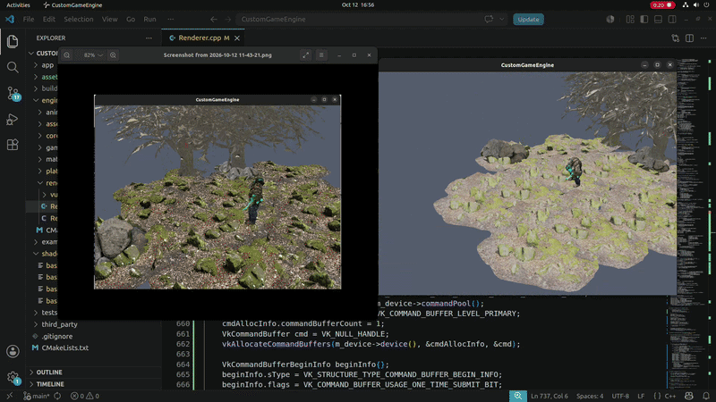
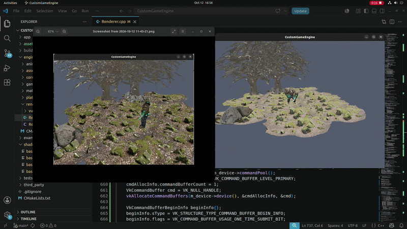
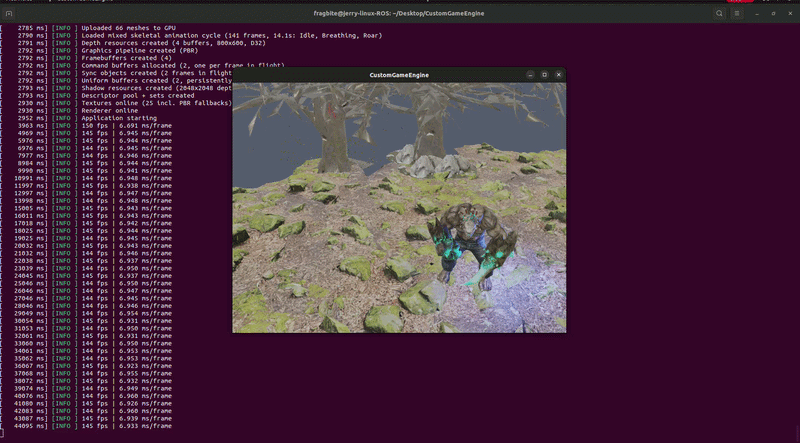

# CustomGameEngine renderer based on Honour of Kings / League of Legends / Dota2 

## Current Status

The engine currently loads and renders a full GLB scene — environment, character, 22 PBR textures, ~66 meshes — with working lighting, depth, and a custom shading pipeline, locked at 144 FPS vsync on an RTX 3060.

**What's done:**

- **Vulkan core from scratch**  instance, validation layers with a custom debug callback, physical device selection with scoring (it correctly ignores the lavapipe software device), logical device, swapchain, image views, render passes
- **Frame architecture**  2 frames in flight, fences + semaphores for CPU/GPU sync, per-frame uniform buffers with persistent mapping
- **GLB/glTF asset pipeline**  custom loader on tinygltf: node transform baking, skinned-mesh handling, KHR_texture_transform UV support, and material extraction (base color, metallic/roughness, normal maps)
- **PBR rendering**  Cook-Torrance BRDF (GGX distribution, Smith geometry, Schlick Fresnel), metallic/roughness workflow, hemisphere ambient, ACES tone mapping, output gamma correction, distance fog
- **Texture pipeline**  GPU-side mipmap generation via blit chains with per-level layout barriers, anisotropic filtering (16x), staging-buffer uploads to device-local memory
- **Depth testing**  D32 depth buffer, correct occlusion for the whole scene
- **Alpha-tested foliage**  discard-based alpha testing for leaves and canopy geometry

**In progress:**

- Shadow mapping (next)
- Skeletal animation + GPU skinning (the GLB has 15 clips waiting)
- Input → Actor/Controller → Animation State Machine — the full gameplay stack

## Demo

<p align="center">
   
</p>

<p align="center">
   
</p>

<p align="center">
   
</p>


## Build

Tested on Ubuntu 22.04, NVIDIA proprietary driver.

```bash
git clone https://github.com/YOUR_USERNAME/CustomGameEngine.git
cd CustomGameEngine
cmake -S . -B build -G Ninja -DCMAKE_BUILD_TYPE=Debug
cmake --build build
./build/CustomGameEngine
```


**Folder Structure:**

```bash
engine/
├── core/        Application, frame loop, logging
├── platform/    SDL3 windowing & events (the only SDL-touching code)
├── renderer/    Vulkan: context, device, swapchain, Renderer
├── assets/      GLB loading, MeshData, texture extraction
├── animation/   (empty for now — Phase 21)
└── gameplay/    (empty for now — Phase 25)
shaders/         GLSL → SPIR-V, compiled in-build
third_party/     glm, tinygltf (vendored)

```

## Roadmap

**Rendering (done) → shadows → skeletal animation → GPU skinning → input system → actor/controller architecture → animation state machine → playable character, MOBA-style. Performance profiling with real measurements throughout.**


